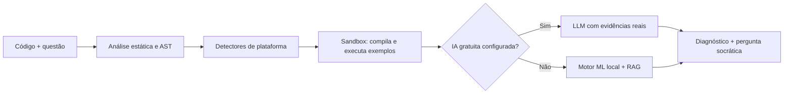

# Code Monitor Copilot

Copiloto de bancada para **instrutores e monitores** de programação competitiva e algoritmos.
Recebe o código do aluno (**C, C++ ou Python**), a questão (texto, link ou foto) e devolve em segundos:
**onde está o erro, um caso de teste que quebra o código, como corrigir e uma pergunta socrática** para destravar o aluno sem entregar a resposta.

Funciona com questões do **NEPS Academy, Beecrowd, Codeforces, AtCoder, CSES** e listas próprias de aula.

---

## Sumário

- [Como usar na bancada](#como-usar-na-bancada)
- [Recursos](#recursos)
- [Como o diagnóstico funciona](#como-o-diagnóstico-funciona)
- [Instalação local](#instalação-local)
- [Docker](#docker)
- [Variáveis de ambiente](#variáveis-de-ambiente)
- [API](#api)
- [Estrutura do projeto](#estrutura-do-projeto)
- [Testes e qualidade](#testes-e-qualidade)
- [Segurança](#segurança)
- [Limitações conhecidas](#limitações-conhecidas)

---

## Como usar na bancada

1. Escolha a linguagem (**C++**, **C** ou **Python**) e, se souber, o veredito do juiz (WA, TLE, RTE, PE, CE).
2. **Cole o código do aluno** no editor (ou envie/cole um print com `Ctrl+V`).
3. *(Opcional)* Cole o **enunciado**, os **limites** (ex.: `N <= 10^5`) ou o **link da questão** — o sistema importa enunciado e exemplos automaticamente.
4. *(Opcional)* Informe uma **entrada e saída de exemplo** para executar o código de verdade.
5. Clique em **Analisar código** (`Ctrl+Enter`).

O resultado mostra:

| Bloco | Para que serve |
| :--- | :--- |
| **O que foi encontrado** | Causa raiz, com a linha destacada no editor |
| **Caso de teste que quebra** | Entrada mínima para mostrar ao aluno |
| **Como corrigir** | Orientação técnica para o monitor |
| **Pergunta para o aluno** | Pergunta socrática pronta para copiar |

> **Modo aluno (sem spoiler):** esconde a causa raiz e a correção, deixando na tela apenas o caso de teste e a pergunta — ideal para virar o notebook para o aluno.

---

## Recursos

- **Execução real em sandbox** — compila C/C++ com `g++`/`gcc` (`-Wall -Wextra`, ASan/UBSan opcional) e executa Python em processo isolado, comparando a saída com a esperada (`AC`, `PE`, `WA`, `RTE`, `TLE`, `CE`).
- **Detectores especializados** — mais de 25 armadilhas clássicas: `int` vs `long long`, `i <= n`, `endl` em laço, estado global sem `clear()`, falta de `setprecision`, divisão inteira, `cin >>` antes de `getline`, `1 << k`, `memset` inválido, módulo negativo, matriz `[[0]*m]*n`, recursão profunda em Python, entre outras.
- **Motor ML local** — classificador de bugs (`BugMLP`) e de família algorítmica em NumPy puro, mais RAG com referências de YouKn0wWho, CSES, Codeforces, AtCoder e Maratona SBC.
- **IA gratuita opcional em cascata** — Groq → OpenRouter → GitHub Models → Ollama → motor local. A IA recebe a saída real do compilador/sandbox, o que reduz alucinações.
- **Importação por link** — NEPS, Beecrowd, AtCoder, CSES e Codeforces (com catálogo offline de 3.500+ questões quando o site bloqueia).
- **OCR de prints** — `Ctrl+V` com imagem do código ou do enunciado.
- **Interface responsiva** — editor CodeMirror com destaque de sintaxe e da linha do erro; funciona no celular.
- **Acesso por PIN** — opcional, para restringir o uso à equipe.

---

## Como o diagnóstico funciona



Prioridade das evidências: **erro de compilação real > erro de execução/sanitizer > diferença na saída > detectores estáticos > modelo ML**.

---

## Instalação local

Requisitos: **Python 3.10+** e, para C/C++, **g++/gcc** no `PATH`.

```bash
python -m venv .venv
# Windows: .venv\Scripts\activate   |   Linux/macOS: source .venv/bin/activate
pip install -r requirements.txt
uvicorn api.index:app --reload --port 8000
```

Acesse `http://127.0.0.1:8000`.

---

## Docker

A imagem já inclui `g++`, `gcc`, o cabeçalho `<bits/stdc++.h>` pré-compilado (compilações ~5–10x mais rápidas) e roda com menos de 512 MB de RAM.

```bash
docker build -t code-monitor-copilot .
docker run -p 7860:7860 -e MONITOR_ACCESS_PIN=1234 code-monitor-copilot
```

Acesse `http://localhost:7860`. Health check: `GET /health`.

---

## Variáveis de ambiente

Todas são opcionais — sem nenhuma chave, o sistema roda 100% local. Modelo completo em [`.env.example`](.env.example).

| Variável | Descrição |
| :--- | :--- |
| `GROQ_API_KEY` | Chave gratuita do Groq (1ª opção de IA) |
| `OPENROUTER_API_KEY` | Chave gratuita do OpenRouter (fallback) |
| `GITHUB_TOKEN` / `OLLAMA_BASE_URL` | Fallbacks adicionais |
| `MONITOR_ACCESS_PIN` | Exige PIN para usar a ferramenta |
| `GCC_SYNTAX_CHECK` | `0` pula a checagem extra `-fsyntax-only` (recomendado em CPU fraca) |
| `SANDBOX_SANITIZERS` | `1` ativa ASan/UBSan (mais preciso, compila bem mais devagar) |
| `SANDBOX_COMPILE_TIMEOUT` | Tempo máximo de compilação em segundos (padrão `25`) |
| `PORT` | Porta do servidor (padrão `7860` no Docker) |

> As chaves ficam apenas no servidor: nunca vão para o navegador nem para o processo que executa o código do aluno.

---

## API

| Método | Rota | Descrição |
| :--- | :--- | :--- |
| `GET` | `/` | Interface web |
| `GET` | `/health` | Health check leve |
| `GET` | `/api/health` | Status do motor (compilador, IA, PIN) |
| `POST` | `/api/diagnose` | Diagnóstico completo |
| `POST` | `/api/run-tests` | Executa o código em casos de teste |
| `POST` | `/api/chat` | Pergunta de acompanhamento ao copiloto |
| `POST` | `/api/problems/fetch-url` | Importa enunciado e exemplos de um link |
| `POST` | `/api/ocr` | Extrai texto de prints |
| `GET` / `POST` | `/api/problems/custom` | Banco de questões da turma (SQLite) |
| `GET` | `/api/problems/search` | Busca no catálogo offline |
| `POST` | `/api/feedback` | Registra feedback do monitor |
| `POST` | `/api/auth/verify` | Valida o PIN |

Exemplo:

```bash
curl -X POST http://127.0.0.1:8000/api/diagnose \
  -H "Content-Type: application/json" \
  -d '{"language":"python","code":"a,b=map(int,input().split())\nprint(a-b)","test_cases":[{"sample_input":"2 3","expected_output":"5"}]}'
```

---

## Estrutura do projeto

```text
api/index.py               API FastAPI + middleware (PIN, rate limit, headers)
public/index.html          Interface web (CodeMirror, modo aluno)
src/agent.py               Pipeline de diagnóstico (LangGraph)
src/sandbox_runner.py      Compilação e execução isolada dos casos de teste
src/platform_rules.py      Detectores Beecrowd / NEPS / Codeforces / AtCoder
src/micro_checker.py       Erros de sintaxe, variáveis não declaradas, typos
src/static_analyzer.py     Complexidade, laços aninhados, padrões de risco
src/feature_extractor.py   Extração de limites do enunciado e features
src/ml_predictor.py        Inferência do modelo local (NumPy)
src/free_llm_engine.py     Cascata de IA gratuita + chat
src/problem_fetcher.py     Importação por link (com proteção anti-SSRF)
src/vision_ocr.py          OCR de prints
src/rag_retriever.py       Busca nas referências da base de conhecimento
src/storage.py             SQLite (questões da turma e feedback)
data/                      Pesos do modelo, base de conhecimento e catálogo
tests/test_copilot.py      Testes automatizados
```

---

## Testes e qualidade

```bash
ruff check .
pytest -v
```

A suíte cobre análise estática, detectores, sandbox, importação por link, cascata de IA, isolamento de segredos, PIN e proteção anti-SSRF. O CI (GitHub Actions) roda lint e testes a cada push.

O acompanhamento de funcionalidades e pendências está em [CHECKLIST.md](CHECKLIST.md).

---

## Segurança

- Código do aluno roda em diretório temporário, **sem herdar variáveis de ambiente** do servidor e com limites de CPU, memória e tamanho de arquivo (Linux).
- Importação por link bloqueia IPs privados, loopback, link-local e redirecionamentos internos (anti-SSRF).
- Rate limit por IP nas rotas pesadas, limite de tamanho dos payloads e headers `nosniff`, `X-Frame-Options` e `Referrer-Policy`.
- PIN opcional comparado em tempo constante.

---

## Limitações conhecidas

- Sem IA configurada, erros de **lógica específica da questão** (fórmula errada) que compilam e passam no exemplo não são detectados — o sistema avisa e sugere casos de borda.
- Alguns sites (Codeforces, Beecrowd) podem bloquear a importação automática; nesse caso, cole o enunciado ou um print.
- Em servidores com CPU muito limitada, a primeira compilação C++ pode levar alguns segundos.
